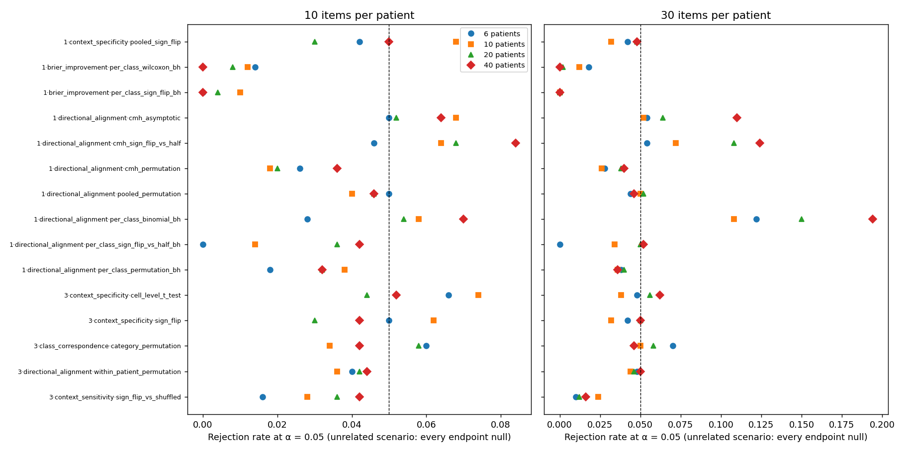
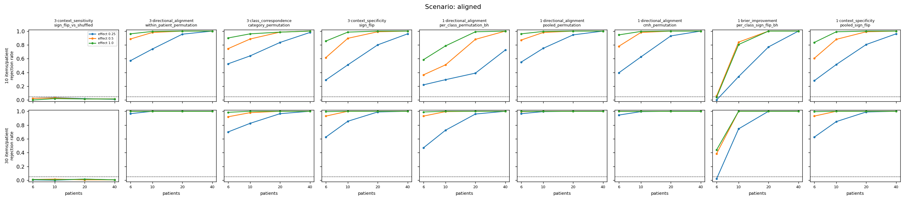
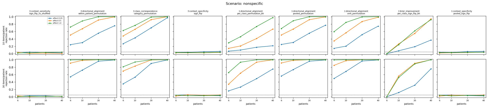
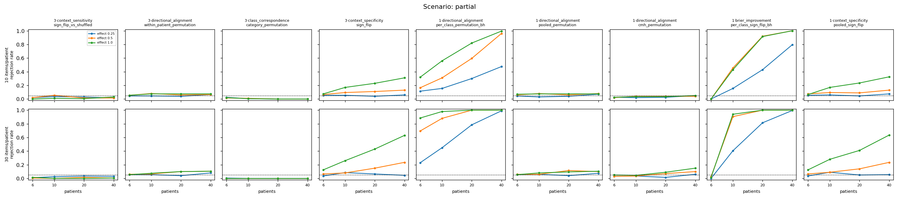
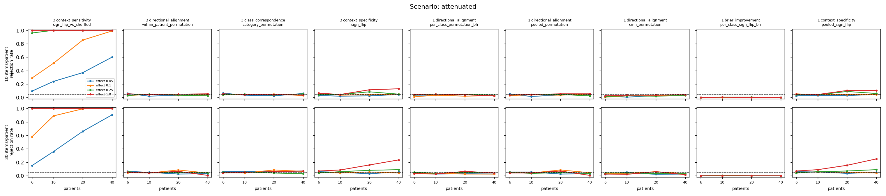
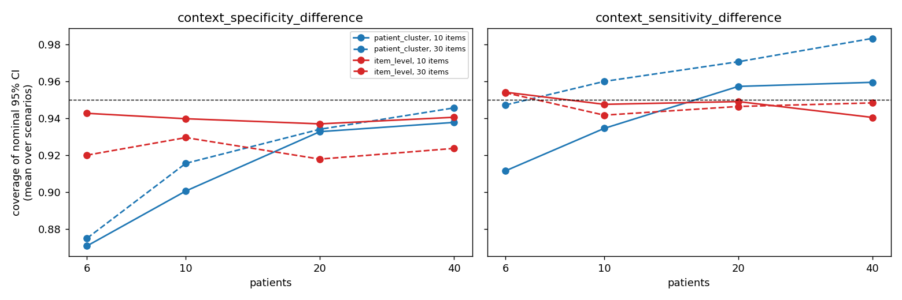
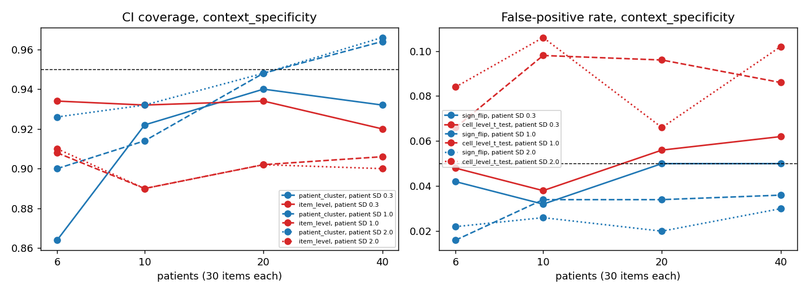

# Simulation study of the endpoints

How often does each endpoint test reject when nothing is there, how much power does it have when something is, and do its confidence intervals cover the truth? None of this can be read off one study, so this page reports a simulation in which the truth is planted. It describes protocol v1 as of [#39](https://github.com/soroushdty/LM-ContextProbe/issues/39).

The study feeds simulated scores straight to the endpoint code: Track 3's `HypothesisAnalyzer` and Track 1's `statistical/hypotheses`. It validates the statistics and tests, not the pipelines that produce the scores. In particular it says nothing about Track 1's Stage 2 training, apart from the separate leave-pair-out simulation described under Track 1's shuffled-context condition in [`methodology.md`](methodology.md).

## How to reproduce

```bash
python scripts/simulate_endpoints.py --out output/simulation          # full study, ~75 min on 16 cores
python scripts/simulate_endpoints.py --quick --out /tmp/sim            # smoke test, seconds
python scripts/simulate_endpoints.py --figures-only --out output/simulation
```

The run on this page used seed 2026 and took 72 minutes on 16 cores. The `attenuated` designs come last in the grid, so every other design has the same replicates as the first version of this study (#18); between the two runs only the three directional-alignment tests studentized in #39 changed. Its settings, the generator's parameters and the Monte Carlo truths used for coverage are in [`simulation/design.json`](simulation/design.json). The summary tables are [`simulation/rejection_rates.csv`](simulation/rejection_rates.csv) and [`simulation/ci_coverage.csv`](simulation/ci_coverage.csv). The per-replicate file (`replicates.csv`, 40 MB) is not committed; the command above recreates it exactly.

## Design

The generator is [`shared/simulation/`](../shared/simulation/README.md).

- **Reference labels.** Two observers label each item without and with context. A context shift has a fixed direction per category (most observers shift up), a patient effect, an item effect and a patient-context × item effect. With the defaults, about a third of reference deltas are non-zero, about two thirds of those are upward, and 80% of them are half-steps from observer disagreement.
- **Model scores.** Context-free, correct-context and shuffled-context scores are rounded to 0.05, like LLM outputs, so many model deltas are exactly zero.
- **Scenarios:**

  | Scenario | The model's context shift | Should reject |
  |----------|---------------------------|---------------|
  | `unrelated` | Unrelated to the reference (its own patient effect plus noise) | Nothing |
  | `aligned` | Follows the shift that the context it is given implies, with effect size *d* | `directional_alignment`, `class_correspondence`, `context_specificity`, `brier_improvement` |
  | `nonspecific` | The same whatever the context: it has learned which items move and in which direction | `directional_alignment`, `class_correspondence`; **not** `context_specificity` |
  | `partial` | As `aligned`, but reversed in half the categories | Per-class tests, not pooled ones |
  | `attenuated` | Unrelated to the reference, as in `unrelated`, but with another patient's context the whole shift is shrunk by a fraction *a* | `context_sensitivity` only |

- **Grid.** 6, 10, 20 and 40 patients; 10 and 30 items per patient; *d* = 0.25, 0.5 and 1.0, and for `attenuated` *a* = 0.05, 0.1, 0.25 and 1.0 (1.0: the model does not move at all with another patient's context). There are 500 replicates per null design and 200 per other design, and each test uses 1,000 permutations and 500 bootstrap resamples. At a true rate of 5%, the Monte Carlo standard error of a rejection rate is 1.0 percentage point with 500 replicates.
- **Clustering sub-study.** The `unrelated` scenario is repeated with 30 items per patient and a stronger model patient effect (SD 1.0 and 2.0 instead of 0.3), so a patient's cells are more correlated.

## Results

### False-positive rate



Every confirmatory test keeps its nominal rate. Across the eight designs at α = 0.05:

| Test | Range |
|------|-------|
| Track 3 `context_sensitivity` (sign-flip vs shuffled) | 1.0–4.2% |
| Track 3 `directional_alignment` (within-patient permutation) | 3.6–5.0% |
| Track 3 `class_correspondence` (category permutation) | 3.4–7.0% |
| `context_specificity`, Track 3 / Track 1 (sign-flip) | 3.0–6.2% / 3.0–6.8% |
| Track 1 `directional_alignment`, pooled / CMH permutation | 4.0–5.2% / 1.8–4.0% |
| Track 1 `directional_alignment`, per class (any class after BH) | 1.8–4.0% |
| Track 1 `brier_improvement`, per class (any class after BH) | 0–1.0% |

The Brier test and the CMH permutation test are conservative.
- **Brier improvement:** a model whose shift is unrelated to the reference makes the Brier score *worse*, so this scenario sits inside its one-sided null rather than on its boundary.
- **Directional alignment:** the sign-agreement permutation tests are studentized by the number of cells they count ([#39](https://github.com/soroushdty/LM-ContextProbe/issues/39)). The rate is computed on the cells where both the reference and the model moved, and the model moves most where the reference moves. A permuted model row therefore lands on fewer counted cells (175 on average instead of 239 with 10 patients × 10 items), and the null distribution of the raw rate was too wide. Before #39 these tests rejected in 1.6–2.8% of null replicates (Track 1 per class: 0.4–1.4%). The CMH permutation test (an odds ratio) is not studentized and stays at 1.8–4.0%.

The reference tests are the ones the outputs keep for comparison, and several exceed the nominal rate:
- **Track 1 per-class binomial test:** up to 19.4%.
- **CMH asymptotic test:** up to 11.0%.
- **Sign-flip tests of agreement against 0.5:** up to 12.4%.

Both effects that the confirmatory tests were designed around are visible here. The reference deltas mostly go one way, so agreement above 0.5 is expected by chance. And cells from one patient are not independent.

**Before #36** the directional-alignment tests counted a zero model delta as disagreement. They then rejected in 96–100% of these null replicates (Track 1 per class: 40–100%), because models and observers both move on the same ambiguous items. See [#36](https://github.com/soroushdty/LM-ContextProbe/issues/36) for the before-and-after table.

### Power



Rejection rates for the aligned scenario with 10 items per patient. Track 1's pooled permutation test of directional alignment is within 0.02 of the Track 3 test in every design. Its CMH permutation test, which is not studentized, is up to 0.18 lower with 6–10 patients and 10 items per patient.

| Test | *d* | 6 patients | 10 | 20 | 40 |
|------|-----|-----------|----|----|----|
| Track 3 `directional_alignment` | 0.25 | 0.57 | 0.74 | 0.96 | 1.00 |
| | 0.5 | 0.88 | 0.98 | 1.00 | 1.00 |
| `context_specificity` (Track 3) | 0.25 | 0.29 | 0.51 | 0.80 | 0.96 |
| | 0.5 | 0.62 | 0.90 | 0.99 | 1.00 |
| `class_correspondence` | 0.5 | 0.74 | 0.88 | 0.98 | 1.00 |
| Track 1 `directional_alignment`, per class (BH) | 0.5 | 0.36 | 0.51 | 0.88 | 1.00 |
| Track 1 `brier_improvement`, per class (BH) | 0.5 | 0.06 | 0.84 | 1.00 | 1.00 |

Before #39, Track 3's test had power 0.48, 0.62, 0.92 and 1.00 at *d* = 0.25, and Track 1's per-class test 0.09, 0.22, 0.66 and 0.98 at *d* = 0.5.

With 30 items per patient, the pooled tests of directional alignment, `class_correspondence` and `context_specificity` all have power ≥ 0.92 at *d* = 0.5, even with 6 patients.

The per-class tests split the data ten ways and correct for multiplicity, so they need three to four times as many patients as the pooled tests. With 6 patients, Brier improvement has essentially no power. Its sign-flip test cannot go below p = 1/64 ≈ 0.016, so after BH across ten classes a class can be rejected only when at least four classes reach that floor.

### `context_specificity` separates aligned from non-specific models



A non-specific model shifts every item the way observers tend to shift it, whatever context it is given. It passes directional alignment: at *d* = 0.5 with 20 patients and 10 items, the Track 3 test rejects in 91% of replicates and the Track 1 pooled test in 92%. It also passes class correspondence. That is correct, because it does agree with the observers item by item. `context_specificity` stays at its nominal rate for this model (2–6% in every design) but has power 0.62–1.00 for the aligned model at *d* = 0.5. So `context_specificity` is the endpoint that tells "uses *this* patient's context" apart from "reacts to having context", as [#18](https://github.com/soroushdty/LM-ContextProbe/issues/18) asked.

### Partial alignment



When the model is aligned in half the categories and anti-aligned in the rest, the pooled tests average the two halves away:
- Track 3 directional alignment, Track 1 pooled and Track 1 CMH reject in at most 15% of replicates.
- Class correspondence rejects in ≤ 2%.

Only the per-class tests find it. Track 1's per-class directional alignment reaches 0.96 with 40 patients × 10 items at *d* = 0.5, and 1.00 with 20 patients × 30 items. A pooled null result does not mean "no alignment in any category".

### `context_sensitivity` and models that move more with the correct context



In the `attenuated` scenario the model's shifts are unrelated to the reference in direction, but with another patient's context they are smaller by a fraction *a* ([#40](https://github.com/soroushdty/LM-ContextProbe/issues/40)). Power of Track 3's `context_sensitivity`:

| Items per patient | *a* | 6 patients | 10 | 20 | 40 |
|-------------------|-----|-----------|----|----|----|
| 10 | 0.05 | 0.10 | 0.24 | 0.37 | 0.60 |
| | 0.1 | 0.29 | 0.51 | 0.85 | 0.99 |
| | 0.25 | 0.96 | 1.00 | 1.00 | 1.00 |
| 30 | 0.05 | 0.15 | 0.36 | 0.66 | 0.91 |
| | 0.1 | 0.58 | 0.89 | 1.00 | 1.00 |

From *a* = 0.25 on, power is 1.00 everywhere (0.96 with 6 patients × 10 items). The test pools every cell, so with 20 patients even a 10% smaller response to a mismatched context gives power ≥ 0.85.

Directional alignment, class correspondence and Brier improvement stay at or below 8.5% in every `attenuated` design, with no trend in *a*, as they should, since the directions are unrelated. With 200 replicates a single design's rate has a Monte Carlo SE of about 2 points. **`context_specificity` does not**: it rejects in up to 23.5% of replicates (Track 3) and 25% (Track 1) at *a* = 1.0 with 40 patients × 30 items. This is not a calibration failure; its true value is positive (+0.002 at *a* = 1.0, about an eighth of an aligned model's at *d* = 0.25).
- **Mechanism:** a zero-mean shift on the logit scale still raises the expected score of a low-probability item, and reference shifts mostly go up. So `sign(Δ_ref) · Δ_model` is slightly positive for any model that moves. When correct and shuffled context move the scores equally the bias cancels; when the correct context moves them more, it does not.
- **Reading it:** a positive `context_specificity` means the correct context aligns better *or* moves the scores more. `context_sensitivity` reports the second, so read the two together. [#42](https://github.com/soroushdty/LM-ContextProbe/issues/42) tracks whether to change the endpoint.

### Confidence-interval coverage



The context-specificity difference has a known true value (0 when correct and shuffled context are exchangeable; otherwise a Monte Carlo estimate from 4,000 patients). Coverage of its nominal 95% patient-cluster bootstrap CI, averaged over scenarios:

| Items per patient | 6 patients | 10 | 20 | 40 |
|-------------------|-----------|----|----|----|
| 10 | 0.871 | 0.900 | 0.933 | 0.938 |
| 30 | 0.875 | 0.916 | 0.934 | 0.946 |

With 6–10 patients, the percentile bootstrap over patients undercovers. Read a "95%" interval from such a study as roughly a 90% interval.

The context-sensitivity difference covers at 0.91–0.98 with the patient-cluster bootstrap. In the `attenuated` scenario alone it ranges from 0.85 to 0.995 across designs.

### Why the patient clustering matters



With the default, weak model patient effect, ignoring the clustering costs little here. Item-level bootstrap CIs cover 0.92–0.94, and a cell-level t-test has a false-positive rate of 4–7%. As a patient's cells become more correlated (model patient-effect SD 1.0 and 2.0; 30 items per patient), the tests that treat cells as independent stop holding their level:

| Test (unrelated scenario, 30 items) | SD 0.3 | SD 1.0 | SD 2.0 |
|-------------------------------------|--------|--------|--------|
| Track 1 per-class binomial (BH), 40 patients | 0.194 | 0.450 | 0.538 |
| CMH asymptotic, 40 patients | 0.110 | 0.128 | 0.150 |
| Cell-level t-test of `context_specificity`, 10 patients | 0.038 | 0.098 | 0.106 |
| **Patient-cluster sign-flip test of `context_specificity`, 10 patients** | 0.032 | 0.034 | 0.026 |
| **CMH within-patient permutation, 40 patients** | 0.040 | 0.056 | 0.070 |
| **Track 3 `directional_alignment` (within-patient permutation), 40 patients** | 0.050 | 0.020 | 0.000 |

The studentized sign-agreement permutation tests become conservative as the model's patient effect grows. Track 1's pooled and per-class tests do the same (40 patients: 0.046 → 0.000 and 0.036 → 0.004).

Item-level CI coverage falls to 0.89–0.91. Patient-cluster coverage reaches 0.95–0.97 once there are 20 or more patients.

## Limitations

- **One generative model.** The rates above hold for this model of observers and scores. Different variance components, label rates or score rounding give different numbers; the script's parameters make that easy to explore.
- **Planted effects are not comparable across scenarios.** *d* in `aligned` and *a* in `attenuated` are different scales, and the simulation cannot say what sizes real models show. Its power tables say how large an effect each test needs, not how often real effects are that large.
- **`context_specificity` responds to magnitude** as well as alignment (above, [#42](https://github.com/soroushdty/LM-ContextProbe/issues/42)).
- **Small-sample CIs.** With fewer than about 20 patients the patient-cluster percentile bootstrap undercovers (above). A bias-corrected or studentized cluster bootstrap could do better; this has not been tried.
- **Scores only.** Pipeline effects, such as Track 1's Stage 2 training or LLM parse failures, are outside this study.
